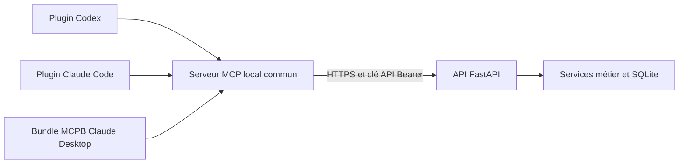

# Codeur Automation — MCP, Codex, Claude Code et Claude Desktop

Le même serveur MCP local pilote **163 opérations** de l'API : missions,
CRM, clients, devis et versions, factures et avoirs, temps, frais, bons de commande,
prospects, campagnes, modèles, sociétés, connaissances, réglages, médias et exports.
Le diagnostic vérifie la santé, l'authentification et les routes déployées.



Le connecteur s'exécute sur le poste du client et exige une version du backend
prenant en charge les clés API MCP. Les règles de facturation, de versionnement
et d'envoi restent appliquées par le backend. L'administration Docker/Portainer
est hors périmètre.

## Créer une clé

Se connecter à Codeur dans le navigateur, puis ouvrir **Paramètres → Accès MCP —
Codex et Claude**. Créer une clé par installation, avec un nom, les droits
« Lecture et écriture » pour toutes les fonctions métier, et une durée de validité
(90 jours par défaut). Copier immédiatement la clé : elle n'est affichée qu'une
fois, dans un champ masqué. Le serveur conserve seulement son empreinte SHA-256.
La révocation est immédiate depuis cette même page ; remplacer la clé dans le
client pour effectuer une rotation. Les clés expirées ou révoquées sont refusées.

Une clé concerne toute l'instance et ses entreprises. Les droits « Lecture seule »
sont contrôlés par le serveur, même avec un autre client HTTP. Une clé MCP ne peut
ni créer ni révoquer de clés, ni ouvrir une session navigateur. La gestion des clés
exige une session navigateur authentifiée et `APP_PASSWORD` configuré côté serveur.
Le mot de passe de l'application n'est jamais demandé par le connecteur.

## Claude Desktop

Télécharger le `.mcpb` depuis les
[releases Codeur](https://github.com/ezeeFlop/claude-plugins/releases/tag/codeur-mcp-v0.1.0),
ou construire `dist/codeur-automation-0.1.0.mcpb`. L'ouvrir avec Claude Desktop.
L'écran de configuration de l'extension demande :

- l'URL de l'instance, par défaut `https://codeur.sponge-theory.dev` ;
- la **Clé API Codeur**, dans un champ obligatoire et sensible (`sensitive: true`) ;
- le dossier où enregistrer les téléchargements ;
- éventuellement le mode lecture seule.

Le bundle contient le serveur et ses dépendances. Il utilise le runtime Node de
Claude Desktop ; aucun Python, `uv`, dépôt Git ou `npm install` n'est nécessaire
sur le poste destinataire. Le champ sensible confie le stockage de la clé à Claude
Desktop et l'injecte dans le processus local, jamais dans le bundle distribué.
Le bundle n'est pas signé et n'est pas soumis à un annuaire. Ne pas saisir la clé
dans la conversation. Les paramètres de l'extension permettent de la remplacer.

## Plugins Codex et Claude Code

Node.js 20 ou plus récent doit être disponible pour les clients CLI.

```sh
# Codex : marketplace publique Sponge Theory.
codex plugin marketplace add https://github.com/ezeeFlop/claude-plugins.git
codex plugin add codeur-codex@sponge-theory-codex

# Depuis le dossier installé du plugin Codex, sur macOS :
node server.cjs --setup --gui --client codex
```

Dans Claude Code : `/plugin marketplace add ezeeFlop/claude-plugins`, puis
`/plugin install codeur@sponge-theory`. Renseigner le champ sensible du plugin,
ou, sur macOS, lancer `node server.cjs --setup --gui --client claude-code` depuis
son dossier installé. Recharger le plugin ou démarrer une nouvelle session si le
client ne recharge pas automatiquement ses outils.

L'assistant macOS demande l'URL puis la clé avec une saisie masquée, vérifie son
accès et l'enregistre dans une entrée dédiée du trousseau. Les profils sont séparés
par client dans `~/.config/codeur-mcp/<client>/connection.json` ; ils contiennent
l'URL et des métadonnées, aucun secret. Les services du trousseau sont
`ai.sponge-theory.codeur.codex.v1` et `ai.sponge-theory.codeur.claude-code.v1` ; le
compte est l'empreinte SHA-256 de l'URL normalisée.

La règle de publication Codex impose un lecteur natif stable, installé hors des
caches de plugins : `~/.sponge-theory/codeur-keychain/v1/spt-codeur-keychain`.
Son empreinte est vérifiée avant chaque accès. Les mises à jour ordinaires ne le
recompilent pas. Le runtime lit exclusivement sa propre entrée, sans dialogue ;
une erreur invite à relancer la configuration. Ni les secrets d'autres plugins
ni le `.env` du serveur ne servent de repli. La clé transite par un pipe privé,
jamais par les arguments d'un processus ou les logs.

Pour un autre système, ou un lancement personnalisé, utiliser les variables :

| Variable | Usage |
|---|---|
| `CODEUR_URL` | URL de l'application, HTTPS sauf localhost |
| `CODEUR_API_KEY` | Clé API transmise au processus, jamais un argument de commande |
| `CODEUR_CLIENT` | Profil `codex`, `claude-code` ou `desktop`, défini par le paquet |
| `CODEUR_OUTPUT_DIR` | Dossier des exports ; défaut `~/Downloads/Codeur` |
| `CODEUR_READ_ONLY` | `true` interdit les écritures métier ; exports locaux autorisés |
| `CODEUR_TIMEOUT_SECONDS` | Délai HTTP de 1 à 3600 secondes ; défaut 1200 |
| `CODEUR_CONFIG_PATH` | Emplacement alternatif du fichier de configuration locale |

Les variables prennent le pas sur le fichier local et le trousseau. Une clé est
obligatoire pour les opérations métier. Sans clé, la découverte du catalogue et
le contrôle de santé public restent disponibles. Les secrets restent hors du
catalogue et des artefacts distribués.

## Utilisation

Exemples de demandes : « montre le pipeline et les devis à relancer », « crée un
brouillon de facture depuis ce devis », « importe ce CSV de prospects », « prépare
la newsletter puis montre l'aperçu », « exporte les factures du mois ».

Les sept outils fournissent une découverte progressive, pour éviter de charger
les 163 schémas à chaque conversation :

| Outil | Rôle |
|---|---|
| `codeur_search_operations` | Recherche française/anglaise, domaines et pagination |
| `codeur_describe_operation` | Schéma exact des paramètres et effet de l'opération |
| `codeur_read` | Consultation des opérations sans effet métier |
| `codeur_write` | Création, édition, suppression, import, génération, envoi |
| `codeur_download` | Enregistrement local d'un PDF, CSV, justificatif ou média |
| `codeur_job_status` | Suivi d'une requête longue sans la relancer |
| `codeur_diagnostics` | Santé, accès et écarts entre le catalogue et l'API déployée |

Les arguments d'une opération sont regroupés dans `parameters.path`, `.query` et
`.body`. Les imports multipart prennent un descripteur fichier dans le champ
correspondant du `body`, par exemple `{"file":{"path":"/chemin/local/brief.pdf"}}`,
ou `{"file":{"base64":"…","filename":"brief.pdf"}}`. La limite du connecteur
est 32 Mio par fichier/réponse ; les limites plus basses de l'API restent applicables.
Les exports portent un nom unique et n'écrasent aucun fichier existant.

Les demandes qui durent plus de 300 ms retournent un `job_id`. Suivre ce job
jusqu'à `completed`, `failed` ou `uncertain`. Quatre requêtes peuvent travailler
en parallèle. Les résultats sont gardés une heure, dans la limite de 200 jobs,
et disparaissent à l'arrêt du connecteur. Le traitement serveur peut continuer
après sa déconnexion : vérifier la fiche ou le journal avant toute relance.
Les timeouts et erreurs serveur ne déclenchent jamais de nouvelle tentative
automatique d'écriture. Un refus 401 n'est jamais rejoué : vérifier la clé, son
expiration et sa révocation dans les paramètres de l'application.

Certaines lectures de l'API ont des effets : consulter un devis peut mettre à
jour son expiration, lire le journal email ou les statistiques d'une campagne
peut rafraîchir son suivi. Elles passent par `codeur_write` et sont donc bloquées
en mode lecture seule. Activer une entreprise change le contexte global de
l'application, y compris celui de ses autres utilisateurs.

Les endpoints de connexion/déconnexion et d'administration des clés sont exclus
du catalogue. La variante SSE de génération de devis est remplacée par la même
génération suivie comme un job. L'interface web et les liens publics de
désinscription ne sont pas des outils.

## Construire et vérifier

```sh
cd mcp
npm ci
npm run catalogue:check
npm run build
npm test
npm run package
```

Pour essayer la marketplace locale : `codex plugin marketplace add ./dist`, puis
`codex plugin add codeur-codex@codeur-local`. Claude Code peut aussi charger
`claude --plugin-dir ./dist/plugins/codeur`.

`catalogue:check` et le test d'intégration utilisent l'environnement Python de
développement du backend (ses dépendances doivent être installées). Le test MCP
démarre une API locale avec une base et des fichiers temporaires, sans schedulers,
envoi email ou appel IA. `CODEUR_TEST_PYTHON` peut désigner un autre interpréteur.
Le build utilise le catalogue versionné et ne lance pas l'API de production.
Depuis la copie `shared/codeur` de la marketplace publique, définir
`CODEUR_SOURCE_ROOT=/chemin/vers/codeur-automation` pour l'export, le contrôle de
dérive et le test d'intégration. Sans backend, ce dernier est explicitement ignoré.
Le helper natif universel macOS est versionné avec son empreinte. Vérifier son
identité avec `python3 scripts/build_keychain.py` ; ne pas le reconstruire lors
d'une publication. Une nouvelle identité exige une version de stockage distincte
et une migration explicitement préparée.

Après une évolution de l'API, exécuter `npm run catalogue`, relire le diff puis
reconstruire. Les nouvelles routes ne sont pas exposées automatiquement à partir
d'un serveur distant. Le contrôle de dérive vérifie les routes et leurs schémas
dans le dépôt ; le diagnostic distant compare seulement la présence des routes.

Les sorties sont dans `dist/` : marketplace locale avec les deux plugins,
répertoire Desktop, `.mcpb` et fichier SHA-256. Le binaire commun est identique
dans les trois paquets. Les licences des dépendances sont jointes.

Références de format : [plugins OpenAI](https://developers.openai.com/plugins/build/plugins),
[MCP Claude Code](https://code.claude.com/docs/en/mcp),
[spécification MCPB](https://github.com/modelcontextprotocol/mcpb/blob/main/MANIFEST.md).
